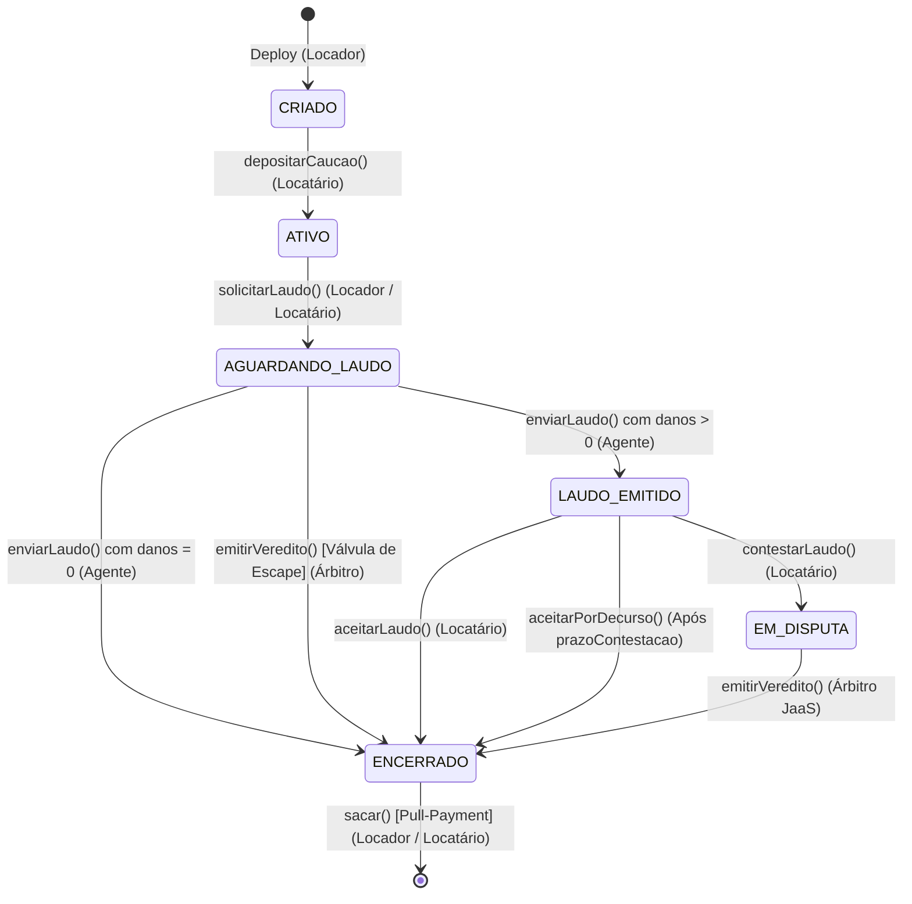

# Caução Locatícia Descentralizada — Prova de Conceito (TCC)

Este repositório contém a Prova de Conceito (PoC) desenvolvida como parte do **Trabalho de Conclusão de Curso (TCC)** sobre a descentralização da custódia de garantias locatícias utilizando **Contratos Inteligentes (*Smart Contracts*)**, **Armazenamento Descentralizado (IPFS)** e resolução de disputas via **Justice as a Service (JaaS)** em redes compatíveis com a Ethereum Virtual Machine (EVM / Layer 2 Base).

---

## 📌 Visão Geral

No modelo tradicional de locação imobiliária (regido no Brasil pela Lei nº 8.245/1991 — Lei do Inquilinato), a custódia da caução em dinheiro frequentemente gera assimetria de poder, atritos na devolução e risco de retenção indevida (*Hold-Up Problem*).

Este protótipo substitui a custódia unilateral por um **cofre autônomo programável (`CaucaoLocaticia.sol`)** que:
1. **Custodia a garantia** em uma *stablecoin* padrão ERC-20 (`MockBRL` — `mBRL`).
2. ** Condiciona a liberação dos fundos** a uma máquina de estados determinística e regras temporais estritas.
3. **Ancora provas documentais (PDFs de vistorias e sentenças)** de forma híbrida: os arquivos ficam no **IPFS** (via Pinata) e seus identificadores criptográficos (**CIDs**) ficam registrados de forma imutável *on-chain*.
4. **Resolve impasses** por meio de mecanismos de decurso de prazo (*anti-holdup* reverso) e arbitragem especializada (*Mutabilidade Controlada / JaaS*).

---

## 👥 Atores e Papéis no Contrato

O contrato exige segregação estrita de funções (quatro endereços distintos no construtor):

| Ator | Papel na Arquitetura | Principais Ações |
| :--- | :--- | :--- |
| **Locador** | Proprietário do imóvel (criador do contrato) | Implantar o contrato, solicitar vistoria ao término do prazo (`FIM_PRAZO`) ou por quebra (`INADIMPLENCIA`) e sacar indenizações devidas. |
| **Locatário** | Inquilino depositante da garantia | Aprovar e depositar a caução (`depositarCaucao`), solicitar `RESCISAO_ANTECIPADA`, aceitar (`aceitarLaudo`) ou contestar (`contestarLaudo`) o laudo e sacar o saldo remanescente. |
| **Agente Verificador** | Oráculo técnico imparcial (Vistoriador) | Realizar a vistoria de saída, submeter o PDF ao IPFS e registrar *on-chain* o CID e o valor das avarias (`enviarLaudo`). |
| **Árbitro (JaaS)** | Instância de resolução de disputas | Analisar contestações no estado `EM_DISPUTA` (ou omissão do Agente em `AGUARDANDO_LAUDO`) e proferir a decisão final (`emitirVeredito`) com o CID da sentença. |

---

## 🔄 Máquina de Estados

O ciclo de vida do contrato é controlado pelo `enum Estado`:



---

## 📂 Estrutura do Repositório

- **`caucao.sol`** — Contrato inteligente principal (`CaucaoLocaticia`), implementado em Solidity `^0.8.24` utilizando `ReentrancyGuard` e `SafeERC20` da OpenZeppelin.
- **`MockBRL.sol`** — Contrato de token ERC-20 (`mBRL`) utilizado para representar o Real tokenizado nos testes de depósito e liquidação da caução.
- **`abi.txt`** — *Application Binary Interface* (ABI) do contrato `CaucaoLocaticia` utilizada pelo front-end para interagir com a blockchain.
- **`index.html` / `app.js` / `styles.css`** — Interface Web3 (DApp) reativa que lê as permissões *on-chain* via `acoesDisponiveis()`, integra com a carteira **MetaMask** (via Ethers.js v6) e realiza o upload de laudos/sentenças para o **IPFS (Pinata)**.
- **`testar_gastos_base_sepolia.js`** — Script automatizado para execução no Remix IDE que simula os **3 cenários de teste** na Layer 2 **Base Sepolia** (Chain ID `84532`) e gera a tabela consolidada de consumo de *Gas*, custos em ETH/BRL e links de auditoria no BaseScan.
- **`arquitetura_contrato.md`** — Documentação teórica e arquitetural do modelo proposto no TCC.


---

## 🛡️ Mecanismos de Segurança e Otimização

- **Padrão *Pull-Payment* (`sacar`) + `ReentrancyGuard`:** O contrato não transfere fundos automaticamente no encerramento (*Push*), evitando ataques de negação de serviço (DoS) e reentrância. Cada parte realiza o resgate do seu respectivo saldo.
- **Mitigação de *Hold-Up* Reverso (`aceitarPorDecurso`):** Caso o Agente aponte danos (`LAUDO_EMITIDO`) e o Locatário permaneça inerte além do `prazoContestacao`, o contrato permite a liquidação por decurso de prazo, impedindo o congelamento dos fundos.
- **Válvula de Escape (*Escape Valve*):** O Árbitro (JaaS) pode intervir tanto em `EM_DISPUTA` quanto em `AGUARDANDO_LAUDO` (caso o Agente de Verificação se torne indisponível), garantindo que os ativos nunca fiquem permanentemente bloqueados.
- **Otimização de *Gas*:** Uso de variáveis `immutable` para parâmetros contratuais fixos e `Custom Errors` (`EstadoInvalido()`, `NaoAutorizado()`, etc.) em substituição a strings em comandos `require`.

---

## 🚀 Como Executar o Protótipo

### Pré-requisitos
- Navegador com a extensão [MetaMask](https://metamask.io/) instalada.
- Rede de testes configurada (ex.: **Base Sepolia** — Chain ID `84532` ou **Ethereum Sepolia**).
- Um servidor HTTP local simples para abrir o front-end (como a extensão *Live Server* do VS Code, `npx serve` ou `python -m http.server`).

### 1. Implantação (Deploy) dos Contratos no Remix IDE
1. Acesse o [Remix IDE](https://remix.ethereum.org/) e importe os arquivos `MockBRL.sol` e `caucao.sol`.
2. Na aba **Solidity Compiler**, compile ambos utilizando a versão `0.8.24` (ou superior compatível).
3. Na aba **Deploy & Run Transactions**, selecione o ambiente **Injected Provider - MetaMask**:
   - Faça o deploy do contrato **`MockBRL`** e emita (`mint`) tokens `mBRL` para a carteira do **Locatário**.
   - Com a conta do **Locador** selecionada, faça o deploy do contrato **`CaucaoLocaticia`** informando no construtor:
     - `_token`: Endereço do contrato `MockBRL`
     - `_locatario`: Endereço da carteira do Locatário
     - `_agente`: Endereço da carteira do Agente Verificador
     - `_arbitro`: Endereço da carteira do Árbitro (JaaS)
     - `_valorCaucao`: Valor em wei (ex.: `3000000000000000000000` para 3.000 mBRL)
     - `_dataFim`: Timestamp Unix de término da vigência
     - `_prazoContestacao`: Prazo em segundos para contestação do laudo (ex.: `86400` para 24h)

### 2. Executando o DApp (Front-end)
1. No topo do arquivo `app.js`, verifique se as constantes `CAUCAO_ADDRESS` e `MOCKBRL_ADDRESS` apontam para os endereços dos seus contratos implantados.
2. Inicie um servidor local na pasta do projeto. Exemplo com Python ou Node.js:
   ```bash
   # Opção 1: Python
   python -m http.server 8080

   # Opção 2: Node.js
   npx serve .
   ```
3. Acesse `http://localhost:8080` no navegador, clique em **Conectar MetaMask** e alterne entre as contas (Locador, Locatário, Agente e Árbitro) na MetaMask para executar cada etapa da linha do tempo.

### 3. Reproduzindo os Testes Automatizados na Layer 2 (Base Sepolia)
Para rodar a bateria completa dos 3 cenários avaliados no TCC (**Cenário 1:** Sem Danos / **Cenário 2:** Acordo Amigável / **Cenário 3:** Disputa e Arbitragem JaaS):
1. No [Remix IDE](https://remix.ethereum.org/), compile `MockBRL.sol` e `caucao.sol`.
2. Abra o arquivo `testar_gastos_base_sepolia.js`, insira a chave privada de uma conta de testes da rede **Base Sepolia** (com saldo de ETH de teste) na configuração e clique em **Run**.
3. O console exibirá os blocos minerados, os hashes das transações no [BaseScan Sepolia](https://sepolia.basescan.org/) e a tabela consolidada de custos em *Gas*, ETH e BRL.

---

## 📄 Licença

Distribuído sob a licença **MIT**. Desenvolvido para fins acadêmicos e de pesquisa científica (TCC).
