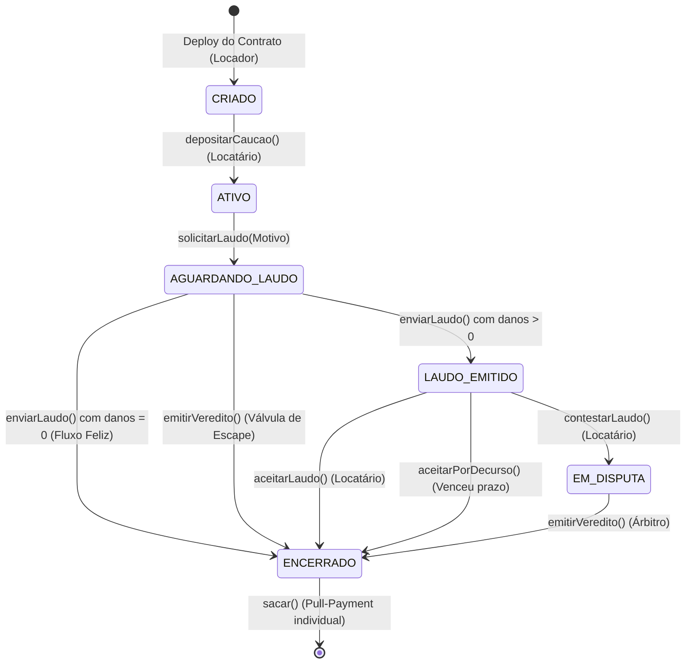

# Metodologia de Implementação e Avaliação Experimental

Este documento consolida a **Metodologia** completa do Trabalho de Conclusão de Curso (TCC), detalhando o projeto arquitetural, a pilha tecnológica, a máquina de estados, o modelo de governança e o protocolo experimental dos testes de consumo de gas. 

Ele serve como **guia definitivo e checklist** para garantir que o texto da monografia reflita com exatidão a implementação final, evitando discrepâncias com versões anteriores.

---

## 1. Classificação da Pesquisa e Abordagem Metodológica

A pesquisa classifica-se como:
* **De Natureza Aplicada:** Tem como objetivo produzir conhecimento voltado à resolução de um problema prático do mercado imobiliário — a ineficiência, assimetria de poder e custos associados à custódia da caução locatícia (Lei nº 8.245/1991).
* **Com Abordagem Metodológica baseada em *Design Science Research* (DSR):** Focada na concepção, desenvolvimento e avaliação empírica de um artefato computacional (*smart contract* e protótipo Web3 descentralizado).
* **De Procedimento Experimental:** Avaliação do artefato por meio de execuções automatizadas em ambiente de teste real de *Layer 2* (Base Sepolia), com mensuração determinística de métricas computacionais (unidades de *Gas* consumidas, blocos minerados e custo financeiro).

---

## 2. Pilha Tecnológica (*Tech Stack*) Atualizada

| Componente | Tecnologia Adotada | Justificativa Técnica |
| :--- | :--- | :--- |
| **Linguagem de Smart Contract** | **Solidity `^0.8.24`** | Versão moderna com suporte nativo a proteções contra *overflow/underflow*, *Custom Errors* e *Cancun/Shanghai EVM opcodes*. |
| **Rede Blockchain (Ambiente)** | **Base Sepolia (Layer 2 - OP Stack)** | Rollup Optimistic da Coinbase (Chain ID `84532`). Garante taxas de gas irrisórias (sub-centavo) e finalidade em ~2 segundos, superando a inviabilidade econômica da Layer 1. |
| **Padrão de Tokenização** | **ERC-20 (`MockBRL.sol`)** | Pareamento fixo 1:1 com o Real Brasileiro com 18 decimais, eliminando o risco da volatilidade cambial das criptomoedas na caução. |
| **Bibliotecas de Segurança** | **OpenZeppelin Contracts v5** | Utilização de `ReentrancyGuard` (anti-reentrância no saque) e `SafeERC20` (transferências seguras de tokens ERC-20). |
| **Armazenamento de Laudos** | **IPFS descentralizado via Pinata** | Armazenamento *off-chain* de relatórios periciais em PDF com ancoragem *on-chain* de hashes criptográficos (CID). |
| **Ambiente de Desenvolvimento** | **Remix IDE & Scripts Ethers.js** | Compilação, depuração e orquestração de testes automatizados via RPC com signers autônomos. |
| **Interface com Usuário** | **HTML5, Vanilla CSS3 e JavaScript Web3** | Interface responsiva reativa à MetaMask, sem *frameworks* pesados, garantindo transparência auditável do código. |

### 2.1. Justificativa do Ambiente Experimental: Testnet (Base Sepolia) como Réplica da Mainnet
A experimentação prática foi conduzida na testnet pública oficial **Base Sepolia**. A adoção deste ambiente como modelo de laboratório para a pesquisa fundamenta-se em três pilares metodológicos:

1. **Fidelidade Arquitetural (*Paridade com a Mainnet*):** A Base Sepolia opera sobre a mesma infraestrutura de código aberto (*OP Stack*) e sob as mesmas regras da máquina virtual (*Cancun EVM*) da rede principal (Base Mainnet). Os tempos de bloco (~2 segundos) e os custos de execução de cada instrução em bytecode são idênticos aos de produção.
2. **Determinismo da Métrica de Gas Usado (`gasUsed`):** Na arquitetura Ethereum, a quantidade de gas consumida por uma transação é estritamente determinística — ditada pela complexidade dos algoritmos e pelo tamanho dos dados gravados em storage (*SSTORE*). Portanto, o volume de gas medido nas simulações na testnet é **rigorosamente o mesmo** que seria consumido caso o contrato fosse publicado na rede principal de produção.
3. **Segurança e Viabilidade Ética da Pesquisa:** A realização de testes empíricos de estresse — incluindo quebra contratual, inadimplência forçada e disputas arbitrais com múltiplas carteiras — exigiu dezenas de iterações. O uso de tokens de teste obtidos via *faucets* permitiu a validação exaustiva do artefato sem impor riscos patrimoniais reais aos pesquisadores durante a fase de prototipagem científica.

---

## 3. Arquitetura da Solução e Segregação de Papéis

O contrato inteligente `CaucaoLocaticia.sol` foi modelado sob o princípio da **Segregação Estrita de Funções**, impedindo que um mesmo endereço público acumule papéis conflitantes:

1. **Locador (`address immutable locador`):**
   * Publica o contrato na rede informando as partes e as regras da locação.
   * Não possui custódia ou poder de saque unilateral dos fundos.
   * Tem permissão restrita para acionar encerramento por término de vigência (`FIM_PRAZO`) ou acusar quebra por falta de pagamento (`INADIMPLENCIA`).
2. **Locatário (`address immutable locatario`):**
   * Realiza a aprovação prévia de saldo e o depósito da caução.
   * Possui prerrogativa de solicitar encerramento por entrega voluntária de chaves (`RESCISAO_ANTECIPADA`).
   * Tem o poder de avaliar o laudo pericial: **concordar** com o desconto ou **contestar formalmente**, enviando a decisão para a arbitragem.
3. **Agente de Verificação / Perito Oráculo (`address immutable agente`):**
   * Ente técnico imparcial (imobiliária, engenheiro ou perito vistoriador).
   * Só pode emitir laudo após ser formalmente solicitado na blockchain por uma das partes.
   * Transmite o CID do laudo pericial (PDF/fotos no IPFS) e o montante em moeda apurado para eventuais danos.
4. **Árbitro / Juiz arbitral (`address immutable arbitro` - *JaaS*):**
   * Atua como instância de resolução definitiva de controvérsias (*Justice as a Service*).
   * Acionado caso haja contestação do inquilino (`EM_DISPUTA`) ou como **Válvula de Escape Emergencial** se o Perito se omitir na fase `AGUARDANDO_LAUDO`.
   * Emite sentença imutável com novo CID no IPFS e partilha financeira obrigatória.

---

## 4. Modelagem da Máquina de Estados (*State Machine*)

O ciclo de vida do aluguel é regido por 6 estados discretos e irreversíveis:

---

## 5. Protocolo Experimental dos Cenários de Teste

Para mensurar o impacto computacional e o consumo de gas, a metodologia definiu **3 cenários canônicos** que cobrem todo o espectro jurídico de um contrato de locação:

### Cenário 1: Fluxo Perfeito (Término Natural Sem Danos)
* **Objetivo:** Avaliar o custo computacional do "caminho feliz", onde o contrato vence normalmente e o imóvel é devolvido em perfeito estado.
* **Sequência Executada:**
  1. `deploy()` do contrato pelo Locador (com `dataFim` configurada para expiração rápida).
  2. `approve()` e `depositarCaucao()` pelo Locatário.
  3. Espera controlada até que `block.timestamp >= dataFim`.
  4. `solicitarLaudo(Motivo.FIM_PRAZO)` pelo Locador.
  5. `enviarLaudo(cid, 0)` pelo Perito $\rightarrow$ Como o valor de avarias é zero, o contrato encerra automaticamente sem abrir prazo de contestação.
  6. `sacar()` pelo Locatário, resgatando 100% da garantia em mBRL.

### Cenário 2: Quebra de Contrato com Acordo Amigável
* **Objetivo:** Avaliar a cobrança de avarias com consenso entre as partes, sem necessidade de litígio.
* **Sequência Executada:**
  1. `deploy()`, `approve()` e `depositarCaucao()`.
  2. Locador aciona `solicitarLaudo(Motivo.INADIMPLENCIA)`.
  3. Perito anexa o laudo via IPFS e imputa R$ 1.000 em danos: `enviarLaudo(cid, 1000)`.
  4. Estado avança para `LAUDO_EMITIDO`. O Locatário analisa o laudo e anui: `aceitarLaudo()`.
  5. Contrato fatia os saldos: R$ 1.000 para o Locador e R$ 2.000 para o Locatário.
  6. Execução de `sacar()` por ambos os beneficiários.

### Cenário 3: Quebra com Disputa e Intervenção Arbitral (JaaS)
* **Objetivo:** Avaliar o pior caso computacional (pior caso de custo de gas), envolvendo discordância, transição de disputa e sentença arbitral.
* **Sequência Executada:**
  1. `deploy()`, `approve()` e `depositarCaucao()`.
  2. `solicitarLaudo(Motivo.INADIMPLENCIA)` e `enviarLaudo(cid, 1000)`.
  3. Locatário não aceita o desconto e aciona a cláusula arbitral: `contestarLaudo()`.
  4. Estado transita para `EM_DISPUTA`.
  5. Árbitro analisa as provas e profere a sentença no IPFS com acordo conciliatório em R$ 500: `emitirVeredito(500, cidVeredito)`.
  6. Estado transita para `ENCERRADO` (R$ 500 Locador / R$ 2.500 Locatário).
  7. Execução de `sacar()` por ambas as partes.

---

## 6. Variáveis de Controle e Parâmetros Pré-setados

A pesquisa isolou variáveis externas para garantir reprodutibilidade e confiabilidade científica:

| Variável | Valor Parametrizado | Racional / Base Legal |
| :--- | :--- | :--- |
| **Garantia Locatícia** | R$ 3.000,00 (`3000 * 10^18` mBRL) | Equivalente a 3 meses de aluguel de R$ 1.000 (teto do art. 38, §2º da Lei 8.245/91). |
| **Avarias Laudo (C2 e C3)** | R$ 1.000,00 mBRL | 1/3 da caução, simulando pintura ou reparos de saída. |
| **Sentença Arbitral (C3)** | R$ 500,00 mBRL | Redução de 50% das avarias como conciliação técnica. |
| **Prazo de Contestação** | 86.400 segundos (24 horas) | Prazo decadencial para o locatário se manifestar antes do *aceite por decurso*. |
| **Cotação de Conversão** | **R$ 12.100,00 / ETH** | Cotação cambial de referência fixada para conversão dos gastos de gas em moeda fiduciária. |
| **Taxa de Prioridade (L2)** | **0.001 Gwei** (`maxPriorityFeePerGas`) | Parâmetro real de mercado para Layer 2 Base Sepolia (idêntico ao gerado pela MetaMask). |
| **Teto de Taxa (L2)** | **0.015 Gwei** (`maxFeePerGas`) | Garante execução rápida em blocos de 2s sem inflar artificialmente as despesas com o default de L1. |

---

## 7. ⚠️ CHECKLIST METODOLÓGICO: O QUE ATUALIZAR NO TEXTO

> **Atenção:** Verifique sua redação atual da monografia para garantir que os seguintes itens estão alinhados com o código final:

- [x] **Rede:** Certifique-se de escrever **Layer 2 Base Sepolia (Rollup OP Stack)** e não "Ethereum Sepolia pura" ou "Mainnet L1". Explique que a migração para Layer 2 foi mandatória pela inviabilidade econômica das taxas da L1.
- [x] **Erros de Validação:** Mencione o uso de **`Custom Errors` do Solidity 0.8** (ex: `error EstadoInvalido()`, `error NaoAutorizado()`) em vez de `require("mensagem longa")`, justificando a redução drástica de *bytecode* e economia de gas.
- [x] **Padrão de Retirada:** Explique que os saques adotam estritamente o padrão **Pull-Payment** (o usuário clica em `sacar()`) para prevenir ataques de *Denial of Service* (DoS) e reentrância, abandonando qualquer lógica de repasse automático (*Push*).
- [x] **Fluxo Feliz Otimizado:** Deixe claro que, quando o laudo tem **0 avarias**, o contrato pula a fase de contestação e vai direto para `ENCERRADO`, permitindo saque imediato pelo inquilino.
- [x] **Válvula de Escape do Árbitro:** Ressalte que o Árbitro pode agir não só em `EM_DISPUTA`, mas também preventivamente em `AGUARDANDO_LAUDO` para evitar que a omissão ou morte do perito trave a caução para sempre.
- [x] **Aceite por Decurso de Prazo:** Descreva a função `aceitarPorDecurso()` como a solução computacional para o problema do *Hold-Up* reverso (impedir que o locatário fujão congele os fundos do locador indefinidamente).
- [x] **Armazenamento de Documentos:** Não diga que os relatórios inteiros estão na blockchain. O texto deve explicitar a arquitetura híbrida: os PDFs e fotos residem na rede **IPFS (via Pinata)** e apenas o identificador criptográfico (`CID`) é gravado no *storage* e nos *Events* do contrato.
